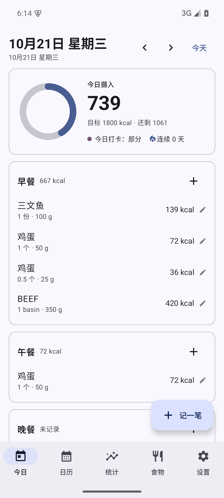
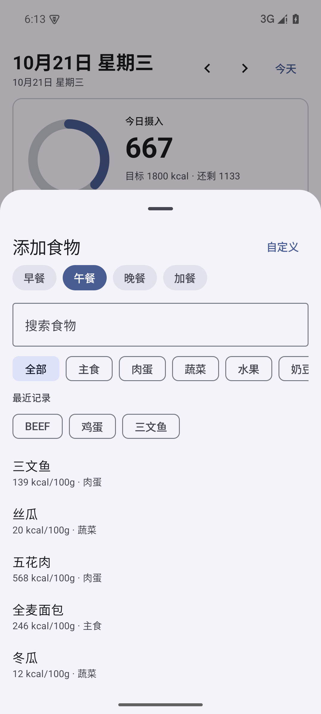
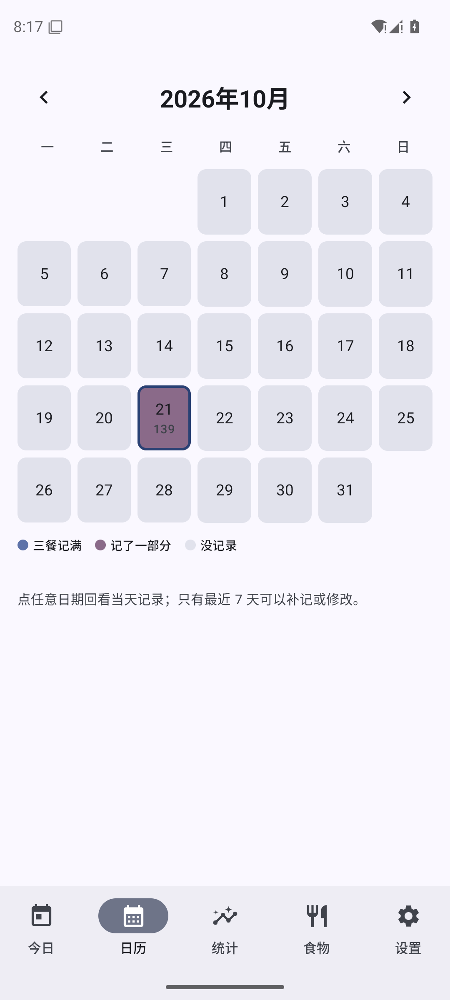
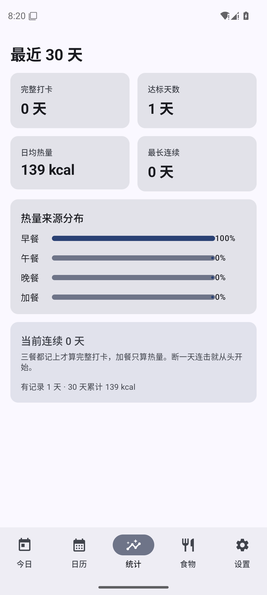
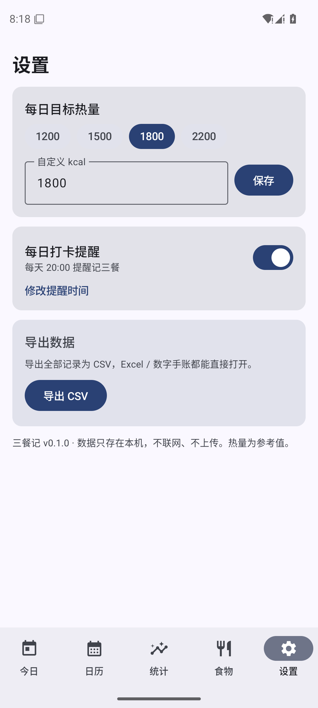
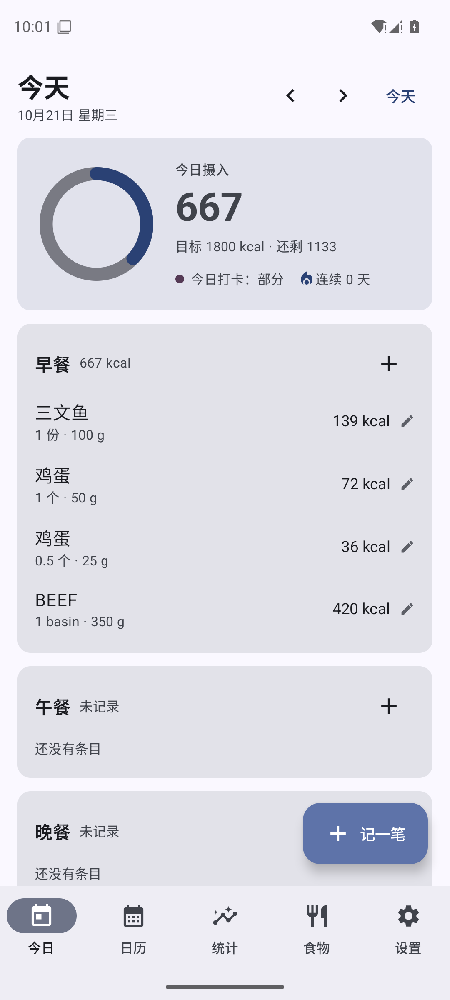
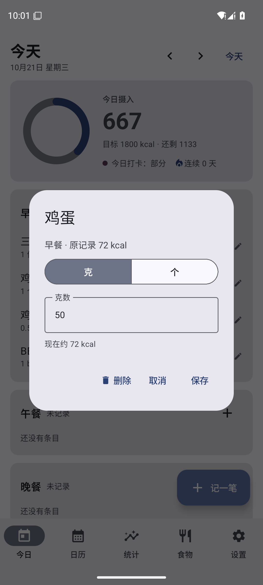

# 三餐记 · MealJournal

安卓端个人饮食热量记录：记一日三餐（食物 + 克数 + 热量），长期打卡复盘。单机离线，数据只在本机。

设计口径见 [`docs/design.md`](docs/design.md)，本文只讲怎么跑、怎么验、做到哪了。

## 功能

| 页面 | 能做什么 |
| --- | --- |
| 今日 | 按早/午/晚/加餐看条目与热量小计；圆环显示目标进度；打卡状态（完整/部分/缺失）+ 连续天数；左右箭头回看历史日期 |
| 添加食物 | 搜索内置约 150 种中文食物，改克数或按「个/碗」算，实时算热量；可新建自定义食物（可填份量单位） |
| 日历 | 月视图，按打卡状态上色（记满/部分/没记录）+ 当日热量；点日期回看 |
| 统计 | 最近 30 天完整打卡数、日均热量、最长连续、三餐热量占比 |
| 我的食物 | 自定义食物的增删 |
| 设置 | 目标热量（1200/1500/1800/2200 或手填）、每日提醒开关与时间、CSV 导出 |

规则：三餐各至少 1 条 = 完整打卡，加餐只计热量；最近 7 天可补记/修改，更早只读（保证历史可信）。

## 截图（模拟器实测）

| 今日 | 添加食物 | 日历 |
| --- | --- | --- |
|  |  |  |

| 统计 | 设置 |
| --- | --- |
|  |  |

| 按份计量（列表） | 编辑条目（克 / 个） |
| --- | --- |
|  |  |

## 构建

环境已在开发机上装好（JDK 21 / Android SDK 36 / Gradle 8.13）。命令行构建：

```powershell
$env:JAVA_HOME='C:\Android\jdk21'
$env:ANDROID_HOME='C:\Android\Sdk'
$env:GRADLE_USER_HOME='C:\Android\gradle-home'
& 'C:\Android\gradle\gradle-8.13\bin\gradle.bat' -p 'E:\project\my' :app:assembleDebug --console=plain
```

产物：`app\build\outputs\apk\debug\app-debug.apk`

单元测试（领域层 27 个用例）：

```powershell
& 'C:\Android\gradle\gradle-8.13\bin\gradle.bat' -p 'E:\project\my' :app:testDebugUnitTest --console=plain
```

## 安装 / 运行

模拟器已建好 `meal_test`（Android 15 / x86_64，AVD 在 `D:\Android\avd`）：

```powershell
$env:ANDROID_AVD_HOME='D:\Android\avd'
& 'C:\Android\Sdk\emulator\emulator.exe' -avd meal_test -no-window -no-audio -gpu swiftshader_indirect
& 'C:\Android\Sdk\platform-tools\adb.exe' install -r app\build\outputs\apk\debug\app-debug.apk
& 'C:\Android\Sdk\platform-tools\adb.exe' shell am start -n com.my.mealjournal/.MainActivity
```

真机：开 USB 调试后 `adb install -r` 同一个 APK 即可（minSdk 26，Android 8.0+）。

## 技术栈

Kotlin 2.2.21 / Compose BOM 2025.06.01 / Material 3 / Room 2.7.2（KSP）/ DataStore / AlarmManager 本地提醒。
包名 `com.my.mealjournal`，`compileSdk 36` / `targetSdk 36` / `minSdk 26`。

```
app/src/main/java/com/my/mealjournal/
├── domain/   纯 Kotlin 规则：热量、打卡判定、连续天数、7 天窗口、份量换算、CSV 拼接
├── data/     Room 实体/DAO/数据库、内置食物种子、仓库、设置存储
├── notify/   每日提醒（AlarmManager + 通知 + 开机重排）
└── ui/       Compose 五个页面 + ViewModel
```

## 已验证（2026-10-21，模拟器）

- `assembleDebug` 通过，APK 28.6 MB；`testDebugUnitTest` 27 个用例全过（含份量换算 6 个）。
- 真机流程跑通：添加「三文鱼 100g」→ 今日 139 kcal、状态「部分」、圆环 7.7%。
- 杀进程重开，数据仍在；日历当天格子显示 139 与「部分」色。
- 回到 8 天前：加号置灰，提示「已超出 7 天补记窗口，仅可查看」。
- `dumpsys alarm` 能看到 `com.my.mealjournal.action.REMIND`，触发时间 20:00。
- CSV 导出到 Downloads，内容：`日期,餐次,食物,克数,每100g热量,热量` + 数据行。
- 按份计量（2026-10-21 第二轮）：0.5 个鸡蛋 → 25 g / 36 kcal；1 bowl（350 g）→ 420 kcal；编辑弹窗可来回切「克 / 个」且数值互转；数据库 1→2 迁移后历史条目仍显示「1 份 · 100 g」。

## 已知限制

- 食物列表按 Unicode 码点排序，不是拼音序；搜索按名称子串匹配。
- 内置热量是公开近似值，界面标注「参考值」。
- 份量单位只覆盖 28 条常吃食物（鸡蛋 50g、米饭 150g/碗、牛奶 250g/杯等），其余按克；单位换算按平均个重/碗重，允许 0.5 份。
- 单机无同步、无账号；换机靠导出 CSV。
- 补记窗口固定 7 天，暂不可配置。
